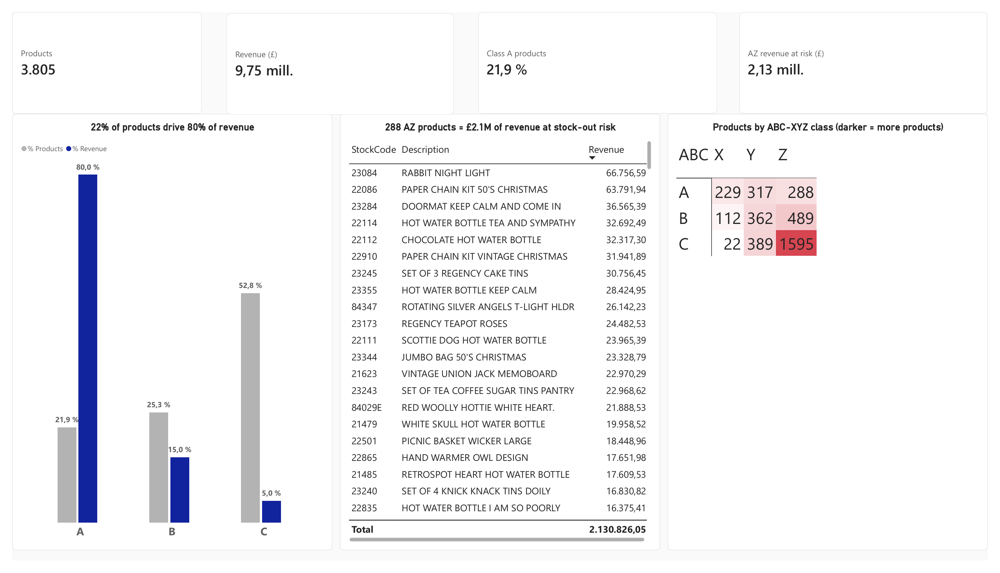

# Inventory ABC-XYZ classification: Excel + Power Query + SQL + Power BI

A UK online gift wholesaler sells 3,805 products. Which ones deserve the most attention, and which ones can be planned with confidence? This project classifies every product by **revenue (ABC)** and by **demand stability (XYZ)** using one year of real sales: 541,909 invoice lines.

The same analysis is done in **Excel**, **SQL** and **Power BI**, and all three give identical numbers.



## The answer in four lines

1. **22% of products drive 80% of revenue.** 834 products are class A; 2,008 products (53%) bring in only 5%.
2. **288 high-revenue products have irregular demand (AZ).** They make £2.13M, 21.8% of all revenue, and are the **biggest stock-out risk**. The top two are seasonal: RABBIT NIGHT LIGHT and PAPER CHAIN KIT 50'S CHRISTMAS.
3. **229 products are AX**: high revenue and stable demand (26.6% of revenue). They are the safest candidates for automatic replenishment.
4. **1,595 products are CZ**: 42% of the catalogue for 3.4% of revenue. Reviewing them could free warehouse space and working capital.

| Products | X (stable) | Y (variable) | Z (irregular) |
|---|---|---|---|
| **A** (80% of revenue) | 229 | 317 | **288** |
| **B** (next 15%) | 112 | 362 | 489 |
| **C** (last 5%) | 22 | 389 | **1,595** |

## Method

- **ABC:** products ranked by net revenue; cumulative share ≤ 80% = A, ≤ 95% = B, rest = C.
- **XYZ:** coefficient of variation (standard deviation ÷ mean) of monthly units over 12 full months (Dec 2010 to Nov 2011). CV ≤ 0.5 = X, ≤ 1 = Y, > 1 = Z. Products whose returns exceed their sales over the year are Z.

## Data

Source: [Online Retail](https://archive.ics.uci.edu/dataset/352/online-retail), UCI Machine Learning Repository (Daqing Chen, 2015), licensed CC BY 4.0. All transactions of a UK-based online retailer between 01/12/2010 and 09/12/2011.

| File | What it is |
|---|---|
| `data/raw/online_retail.csv` | The original 541,909 lines, unchanged (CSV copy of the UCI file) |
| `data/products_clean.csv` | One row per product after cleaning (used by SQL) |
| `data/monthly_sales.csv` | Units per product per month (used by SQL) |

### Data problems found and how they were handled

| Problem | Rows | What I did |
|---|---|---|
| Product codes typed in lower case (`85123a` vs `85123A`) | 1,977 | Upper-cased, so one product is not split in two |
| Price 0 or negative (stock adjustments, "Adjust bad debt") | 2,517 | Removed: not sales |
| Codes that are not products (`POST`, `M`, `BANK CHARGES`, `AMAZONFEE`…) | 2,963 | Removed with a rule: a product code starts with 5 digits (23 such codes found) |
| Cancellations (invoices starting with C) | 8,704 | **Kept.** Removing them invents sales: one order of 80,995 units was cancelled a minute later and would have made a £168,000 product appear |
| Price typed as £649.50 instead of £4.95 (invoices 556444 and 556446) | 2 | Removed. The error was credited with a manual `M` line, which the product rule had already dropped, so the fake £39,600 sale would have stayed |
| December 2011 has only 9 days | — | Excluded from XYZ only, so a half month does not look like a sales drop |
| Months without sales have no row | — | Counted as 0. Without the zeros, 2,372 Z products would shrink to about 800 and seasonal items would look stable |

Rows after cleaning: **536,427** (541,909 − 2,517 − 2,963 − 2).

## Process

1. **Clean** in Power Query (`power-query/retail_abc_xyz.pq`): three queries.
   - `Sales_clean`: the cleaning above, plus `Revenue = Quantity × UnitPrice`. Loaded as connection only.
   - `Products`: grouped by product (one row each).
   - `Monthly`: units per product and month, pivoted to 12 columns with empty months set to 0.
2. **Classify** in Excel (`excel/Retail_ABC_XYZ_Analysis.xlsx`):
   - Cumulative share: `=SUMA($B$2:B2)/SUMA([Revenue])`
   - ABC: `=SI([@[cum%]]<=0,8;"A";SI([@[cum%]]<=0,95;"B";"C"))`
   - XYZ: `PROMEDIO`, `DESVEST.P`, then CV
   - Join: `BUSCARX` brings the XYZ class to each product
   - Matrix: `CONTAR.SI.CONJUNTO` with mixed references (`$A8`, `B$7`)
3. **Check** in SQL (`sql/`): the same results with window functions.
4. **Report** in Power BI (`powerbi/Retail_ABC_XYZ_Dashboard.pbix`): four KPI cards, the 80/20 chart, the AZ risk list and the ABC-XYZ heatmap.

### SQL: cumulative share with a window function

```sql
SELECT stock_code,
       revenue,
       SUM(revenue) OVER (ORDER BY revenue DESC, stock_code
                          ROWS BETWEEN UNBOUNDED PRECEDING AND CURRENT ROW)
       / SUM(revenue) OVER () AS cum_share
FROM products;
```

| Script | What it does |
|---|---|
| `sql/01_create_tables.sql` | Creates and loads both tables, checks row counts and total revenue |
| `sql/02_abc_xyz_analysis.sql` | Ranking (`RANK() OVER`), cumulative share, ABC, XYZ and the ABC × XYZ matrix with CTEs and a JOIN |

Written for PostgreSQL and tested on PostgreSQL 16.

### DAX measures

```DAX
Total Products = COUNTROWS(Products)
Total Revenue  = SUM(Products[Revenue])
% Products     = DIVIDE(COUNTROWS(Products), CALCULATE(COUNTROWS(Products), ALL(Products)))
% Revenue      = DIVIDE([Total Revenue], CALCULATE([Total Revenue], ALL(Products)))
% Products A   = CALCULATE([% Products], Products[ABC] = "A")
AZ Revenue     = CALCULATE([Total Revenue], Products[Class] = "AZ")
```

## Things to keep in mind

- **Revenue is net of returns**, so it is lower than gross sales.
- **XYZ uses units, ABC uses money.** The warehouse cares about how many boxes move; the business cares about how much they earn.
- **The heatmap counts products, not importance.** CZ is the darkest cell, but AZ is the bigger risk.
- **One year of data** cannot separate seasonality from one-off spikes. Two or more years would allow seasonal products to be flagged on their own.

## Tools

Excel · Power Query (M) · PostgreSQL (window functions, CTEs) · Power BI (DAX)

## Author

**Nordin Khloufi** · [LinkedIn](https://www.linkedin.com/in/nordin-khloufi-data) · [GitHub](https://github.com/nordin94)
